# Active Directory Domain Services & Group Policy Infrastructure Lab

This repository documents the end-to-end administration, delegation, health monitoring, and disaster recovery procedures for Group Policy Objects (GPOs) within the `hexelo.com` Active Directory domain environment.

---

## Task 1: Provision Organizational Unit (OU) Hierarchy

To structure domain objects logically for administrative delegation and granular Group Policy application, a departmental Organizational Unit structure is established within Active Directory Users and Computers (`dsa.msc`).

### Step 1: Access Domain Context Menu
1. Opened **Server Manager**, navigated to **Tools**, and launched **Active Directory Users and Computers**.
2. Expanded the domain container `hexelo.com`.
3. Right-clicked the root domain `hexelo.com`, selected **New**, and clicked **Organizational Unit**.

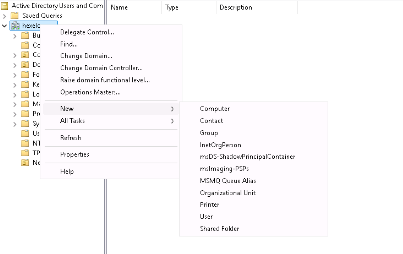

### Step 2: Create Parent Organizational Unit
1. In the **New Object - Organizational Unit** dialog window, entered `New York` in the **Name** field.
2. Verified that **Protect container from accidental deletion** was checked.
3. Clicked **OK** to commit object creation.

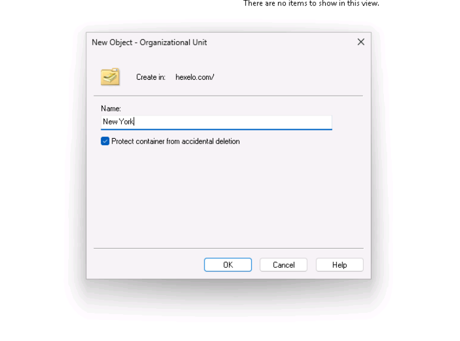

### Step 3: Verify Parent OU Creation
1. Confirmed that the `New York` Organizational Unit is populated directly in the domain directory tree.

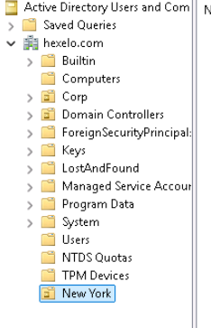

### Step 4: Provision Departmental Sub-OUs
1. Right-clicked the `New York` OU and selected **New** -> **Organizational Unit**.
2. Created a child OU named `IT` and clicked **OK**.
3. Repeated the process under `New York` to create a second child OU named `Marketing`.
4. Verified both subordinate departmental OUs appear nested beneath `New York`.

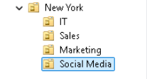

---

## Task 2: Create Central Group Policy Objects (GPOs)

To establish standardized configurations across the domain, custom Group Policy Objects are created centrally within the domain container prior to linking them to target Organizational Units.

### Step 1: Launch Group Policy Management Console
1. In **Server Manager**, opened the **Tools** menu from the top-right toolbar.
2. Selected **Group Policy Management** (`gpmc.msc`).

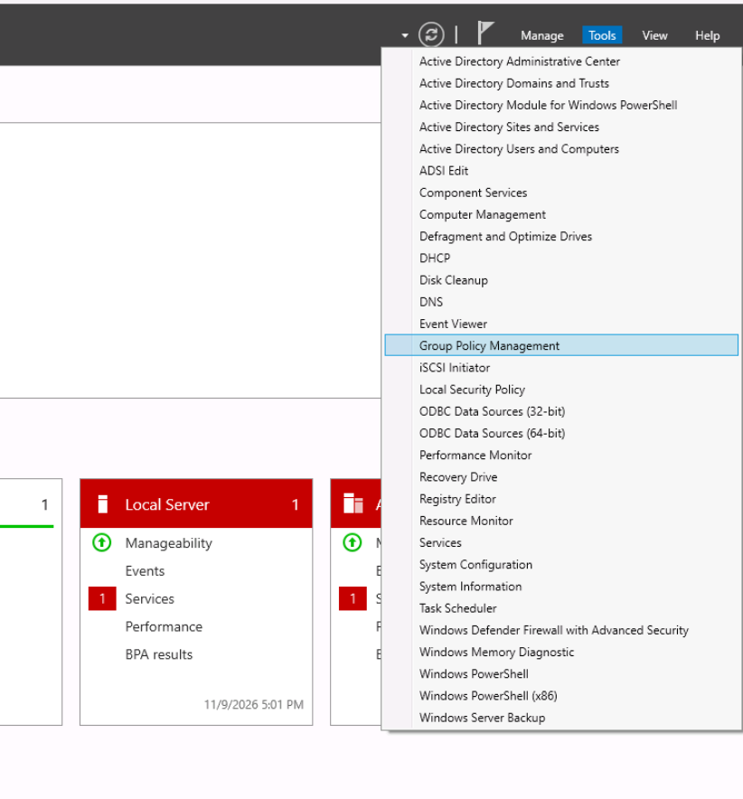

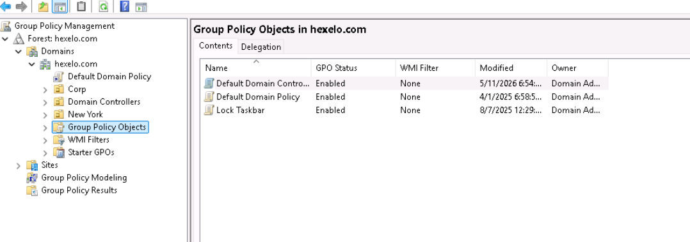

### Step 2: Access Group Policy Objects Container
1. Expanded **Forest: hexelo.com** -> **Domains** -> **hexelo.com**.
2. Right-clicked the **Group Policy Objects** container and selected **New**.

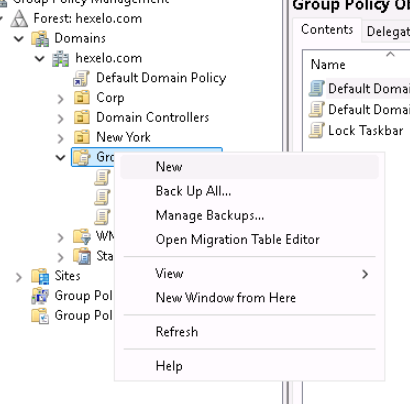

### Step 3: Create Sales Department Policy
1. In the **New GPO** dialog window, entered `Sales Department Policy` in the **Name** field.
2. Left **Source Starter GPO** set to `(none)`.
3. Clicked **OK** to commit object creation.

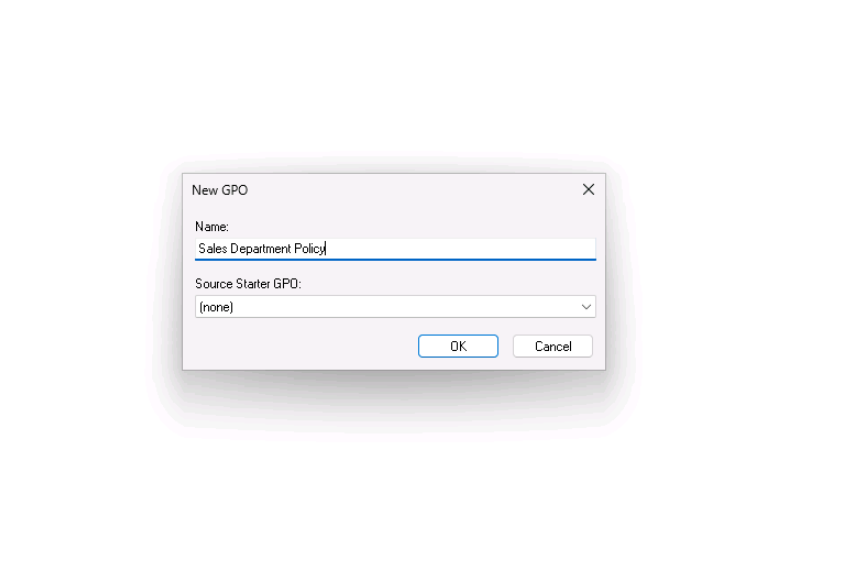

### Step 4: Provision Marketing Department Policy
Following the same process used in Step 3, a second unlinked policy named `Marketing Department Policy` was created inside the **Group Policy Objects** container without a Starter GPO.

Both custom policies are active in the directory and ready for linkage to their respective Organizational Units.

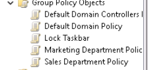

---

## Task 3: Create and Link GPO to the IT Organizational Unit

Group Policy allows administrators to simultaneously create a new Group Policy Object and link it directly to a target Organizational Unit in a single operational step.

### Step 1: Open Context Menu on IT OU
1. In the **Group Policy Management** console tree, expanded **Forest: hexelo.com** -> **Domains** -> **hexelo.com** -> **New York**.
2. Right-clicked the child Organizational Unit named **IT**.
3. Selected **Create a GPO in this domain, and Link it here...**.

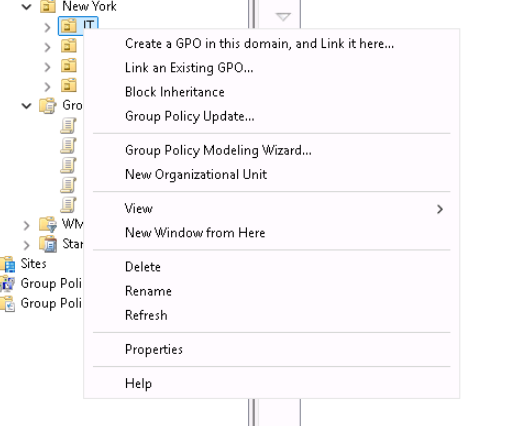

### Step 2: Name and Provision IT Department Policy
1. In the **New GPO** dialog box, entered `IT Department Policy` in the **Name** field.
2. Verified that **Source Starter GPO** remained set to `(none)`.
3. Clicked **OK** to generate the object and bind the link.

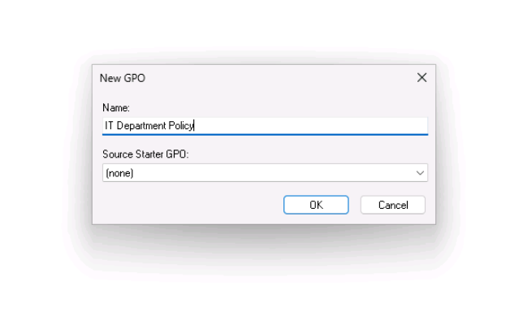

### Step 3: Verify Policy Linkage on IT OU
1. Selected the **IT** Organizational Unit under `New York` in the console tree.
2. Verified that `IT Department Policy` appears directly beneath the `IT` container with a link shortcut icon.
3. In the center pane under the **Linked Group Policy Objects** tab, confirmed that `IT Department Policy` appears with **Link Enabled** set to `Yes` and an **Enforced** state of `No`.

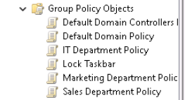

---

## Task 4: Link Existing GPO to Marketing Organizational Unit

When a Group Policy Object has already been created centrally within the domain container, it can be linked to any Organizational Unit to apply its settings to that container's users and computers.

### Step 1: Open Context Menu on Marketing OU
1. In the **Group Policy Management** console tree, expanded **Forest: hexelo.com** -> **Domains** -> **hexelo.com** -> **New York**.
2. Right-clicked the child Organizational Unit named **Marketing**.
3. Selected **Link an Existing GPO...** from the context menu.

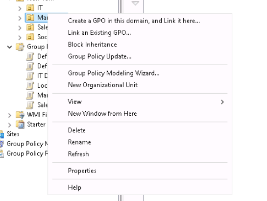

### Step 2: Select GPO to Link
1. In the **Select GPO** dialog window, ensured the domain was set to `hexelo.com`.
2. Selected **Marketing Department Policy** from the **Group Policy objects** list.
3. Clicked **OK** to establish the link.

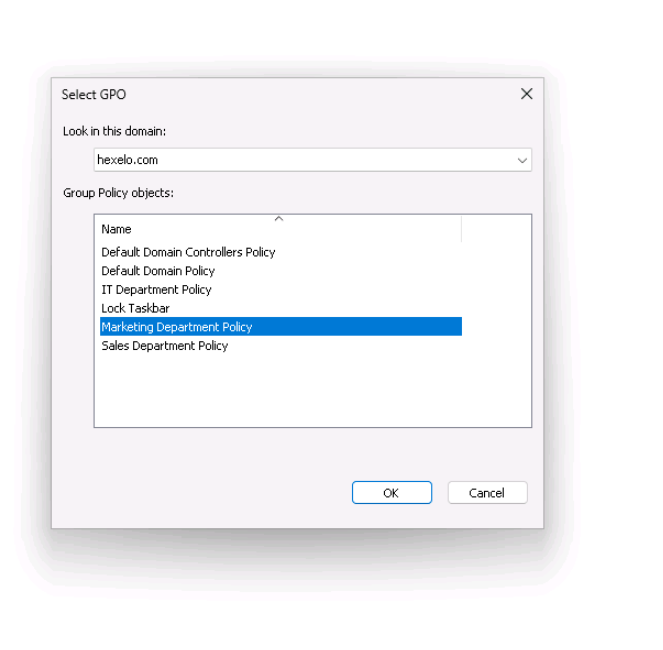

### Step 3: Verify GPO Linkage on Marketing OU
1. In the console tree, selected the **Marketing** Organizational Unit under `New York`.
2. Verified that `Marketing Department Policy` appears directly beneath the `Marketing` container with a link shortcut icon.
3. In the right pane under the **Linked Group Policy Objects** tab, confirmed that `Marketing Department Policy` is listed with **Link Order** `1`, **Link Enabled** set to `Yes`, and **Enforced** set to `No`.

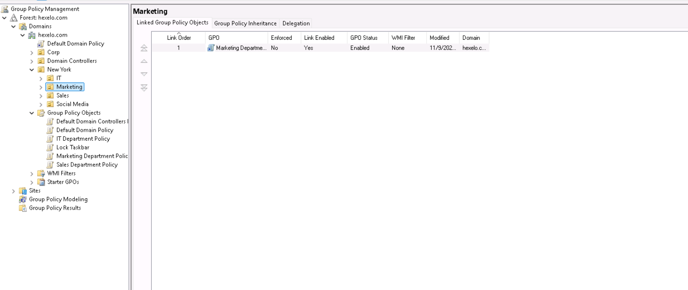

---

## Task 5: Confirm GPO Health and Replication Status

To ensure Group Policy Objects are consistently replicated across all domain controllers and synchronized between Active Directory and the SYSVOL share, the Group Policy Management Console provides built-in infrastructure status detection.

### Step 1: Access Domain Status Overview
1. In the **Group Policy Management** console tree, navigated to **Forest: hexelo.com** -> **Domains**.
2. Selected the root domain container **hexelo.com**.
3. In the right-hand details pane, selected the **Status** tab.

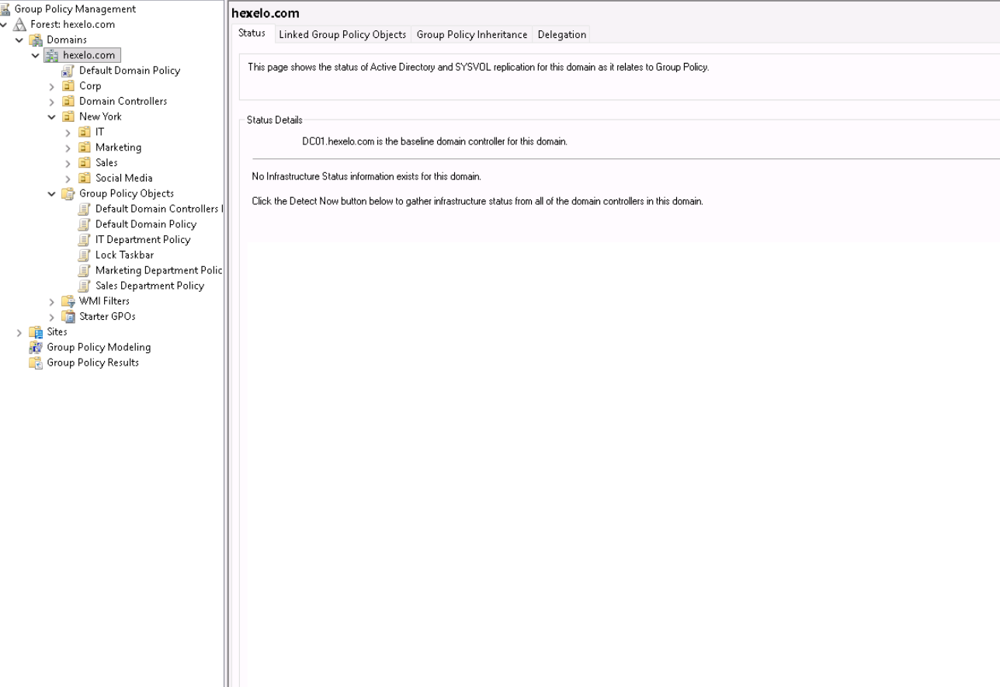

### Step 2: Run Replication and Infrastructure Detection
1. On the **Status** page, clicked the **Detect Now** button to query domain controllers for replication state and Active Directory/SYSVOL policy synchronization.
2. Verified the results displayed green status indicators confirming:
   * **Domain controller replication status:** Replication is in sync across all reachable domain controllers.
   * **Active Directory and SYSVOL status:** Policy versions match with no replication discrepancies detected.

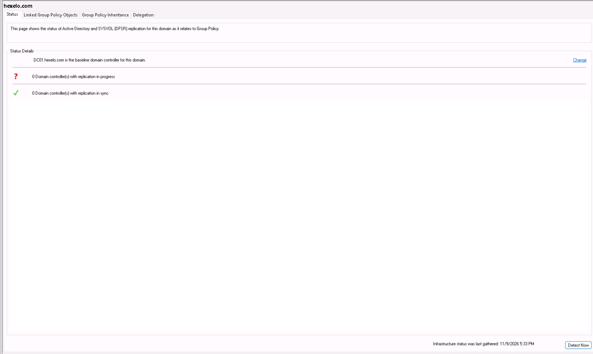

---

## Task 6: Validate Replication and Health for IT Department Policy GPO

In addition to evaluating domain-wide replication, the Group Policy Management Console allows administrators to verify the synchronization state of individual Group Policy Objects between Active Directory Domain Services (AD DS) and the `SYSVOL` folder across domain controllers.

### Step 1: Select IT Department Policy Object
1. In the **Group Policy Management** console tree, navigated to **Forest: hexelo.com** -> **Domains** -> **hexelo.com**.
2. Expanded the **Group Policy Objects** container.
3. Selected **IT Department Policy**.

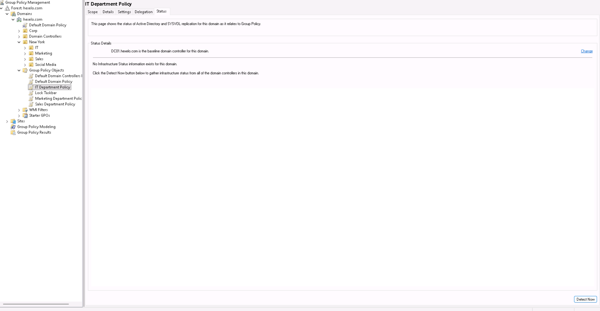

### Step 2: Query Infrastructure Status via Detect Now
1. In the right-hand details pane for **IT Department Policy**, selected the **Status** tab.
2. Clicked the **Detect Now** button to query domain controllers and compare Active Directory directory versions against the `SYSVOL` file system versions.
3. Verified the baseline domain controller is identified as `DC01.hexelo.com` and that replication status indicates synchronized versions between AD and SYSVOL.

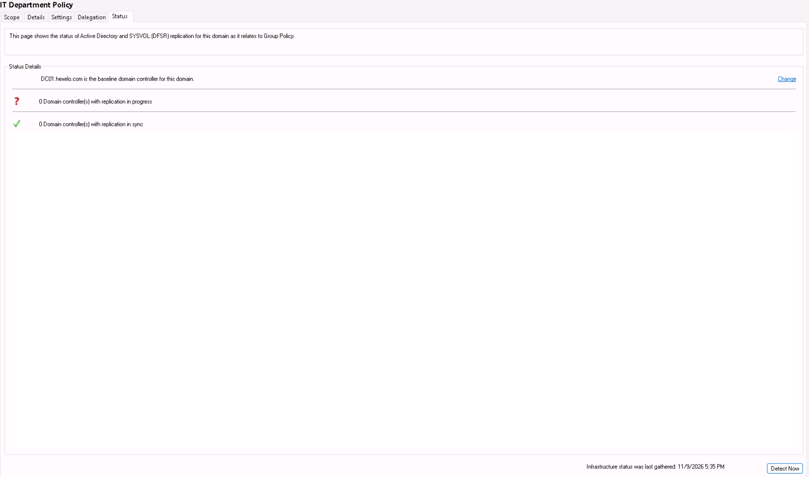

---

## Task 7: Group Policy Object Backup Procedures

Regular backups of Group Policy Objects are essential for disaster recovery and change auditing. The Group Policy Management Console allows administrators to snapshot policy definitions to local or network storage repositories, preserving version histories across multiple backups.

### Step 1: Open Backup Context Menu
1. In the **Group Policy Management** console tree, navigated to **Forest: hexelo.com** -> **Domains** -> **hexelo.com** -> **Group Policy Objects**.
2. Right-clicked **IT Department Policy**.
3. Selected **Back Up...** from the context menu.

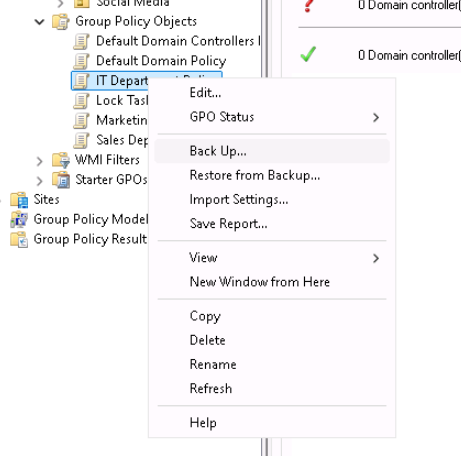

### Step 2: Configure Backup Destination Path
1. In the **Back Up Group Policy Object** dialog box, clicked **Browse...**.
2. In the **Browse For Folder** dialog, expanded **This PC** -> **Local Disk (D:)**.
3. Selected the target folder `LabFiles` and clicked **OK** to set the destination path to `D:\LabFiles`.

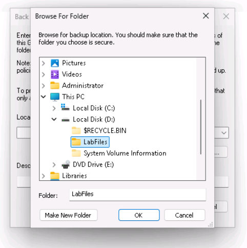

### Step 3: Execute Initial Policy Backup
1. In the **Back Up Group Policy Object** dialog, clicked **Back Up** to generate the unique GUID-based backup directory structure.
2. Verified the **Backup** progress dialog reported **Succeeded (1), Failed (0)** for `IT Department Policy`.
3. Clicked **OK** to close the confirmation dialog.

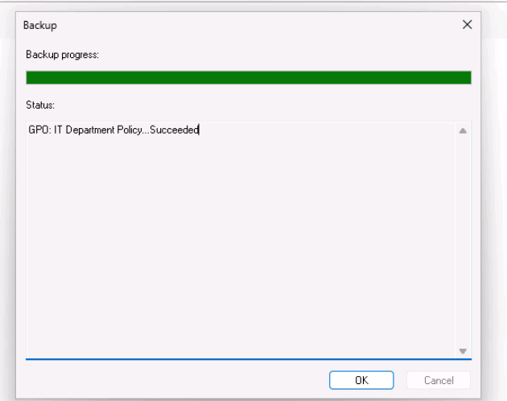

### Step 4: Execute Second Backup Baseline
Following the exact sequence from Steps 1 through 3, a second backup of the `IT Department Policy` was performed to the same destination (`D:\LabFiles`). 

This creates a second unique GUID timestamp entry inside the backup folder, providing multiple restore points for version rollbacks.

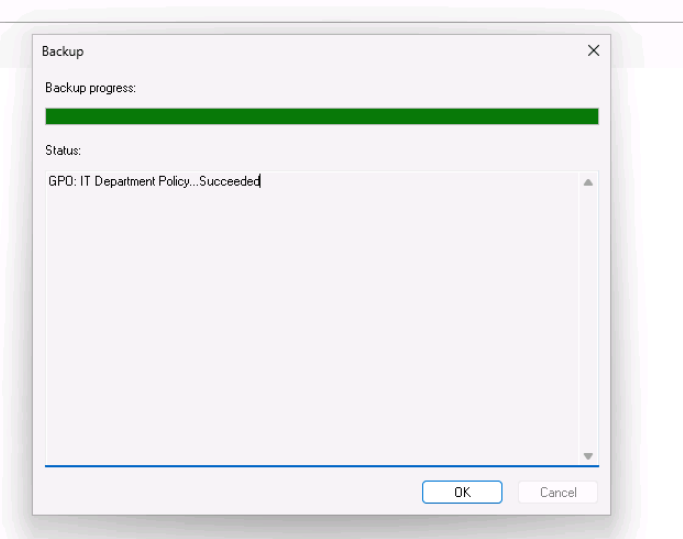

---

## Task 8: GPO Deletion and Link Removal

To test disaster recovery and restoration procedures, the active policy object is removed from the domain directory. Deleting a GPO from the central `Group Policy Objects` container removes both the underlying directory object and all active links associated with it across Organizational Units.

### Step 1: Initiate Policy Deletion
1. In the **Group Policy Management** console tree, expanded **Forest: hexelo.com** -> **Domains** -> **hexelo.com** -> **Group Policy Objects**.
2. Right-clicked **IT Department Policy**.
3. Selected **Delete** from the context menu.

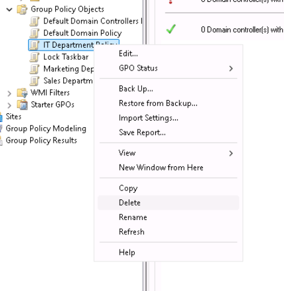

### Step 2: Confirm GPO Deletion
1. In the **Group Policy Management** confirmation dialog (*"Do you want to delete this GPO and all links to it in this domain?"*), selected **Yes**.
2. Verified that the object was removed from the directory structure.

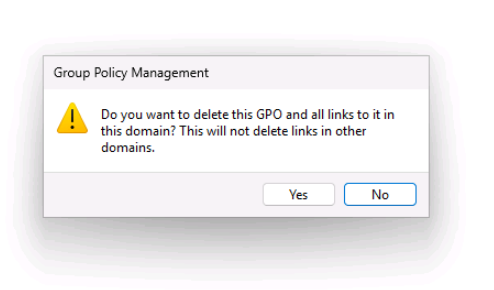

### Step 3: Verify Deletion from Directory and OU Links
1. Selected the **Group Policy Objects** container in the console tree and confirmed `IT Department Policy` is no longer listed.
2. Expanded `hexelo.com` -> **New York** -> **IT** and verified that the linked policy icon under the OU was automatically dereferenced and removed.

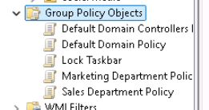

---

## Task 9: Restore Deleted Group Policy Object from Backup

When a policy object is accidentally deleted or corrupted, it can be restored directly from an existing backup repository using the Manage Backups interface in the Group Policy Management Console.

### Step 1: Open Manage Backups Interface
1. In the **Group Policy Management** console tree, expanded **Forest: hexelo.com**.
2. Right-clicked the **Domains** container.
3. Selected **Manage Backups...** from the context menu.

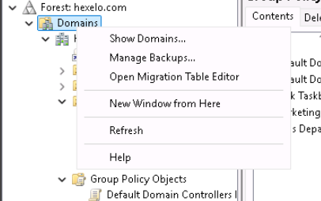

### Step 2: Locate and Select Backup Directory
1. In the **Manage Backups** window, clicked **Browse...** next to **Backup location**.
2. In the **Browse For Folder** dialog, expanded **This PC** -> **Local Disk (D:)**.
3. Selected the `LabFiles` folder (`D:\LabFiles`) and clicked **OK**.

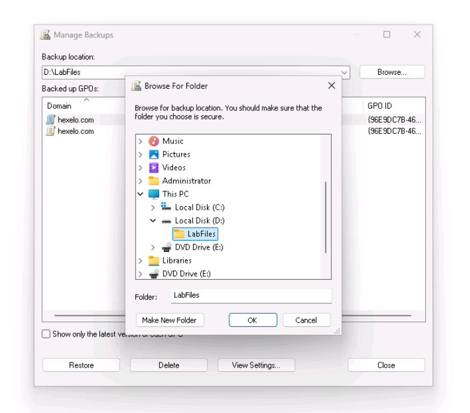

### Step 3: Select Backup Version and Execute Restore
1. In the **Backed up GPOs** list, highlighted a version of the **IT Department Policy** GPO.
2. Clicked the **Restore** button.
3. In the confirmation dialog confirming the restoration outcome, clicked **OK**.
4. Clicked **Close** to exit the **Manage Backups** window.

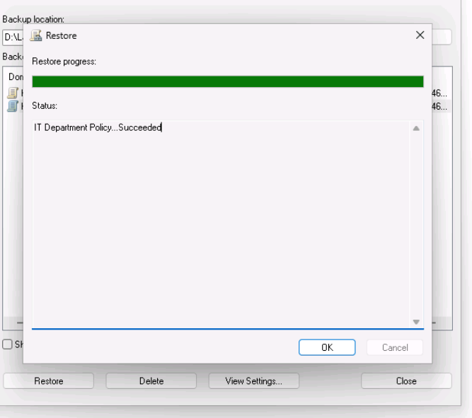

### Step 4: Verify Object Restoration and Re-link Status
1. In the console tree, selected the **Group Policy Objects** container under `hexelo.com`.
2. Verified that **IT Department Policy** is fully restored with its original settings and security filtering intact.

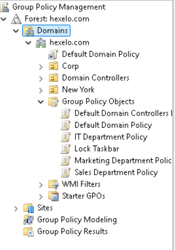
